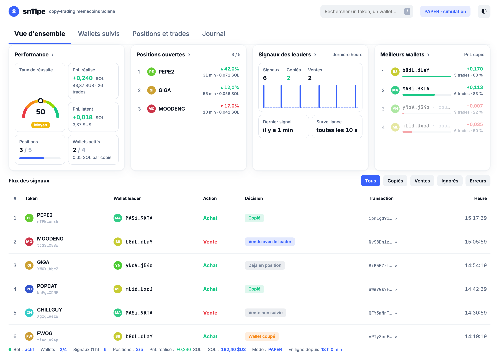

# sn11pe

Bot de copy-trading de wallets memecoins sur Solana. Il surveille des wallets « leaders »,
copie leurs achats via Jupiter (Swap API V2) et sort quand le leader vend, ou sur take-profit / stop-loss / timeout.

> **Avertissement** : projet personnel à but éducatif, pas un conseil financier. Les memecoins sont extrêmement volatils ;
> le mode réel peut faire perdre la totalité des fonds engagés. Utilisation à vos risques.



## Démarrage (paper trading, aucun vrai ordre)

```bash
cp config.example.json config.json   # mettre les adresses des wallets à copier
python3 bot.py                        # boucle de copie simulée (prix réels Jupiter)
python3 bot.py report                 # score de chaque wallet
python3 -m unittest                   # tests
```

Variables d'env optionnelles : `RPC_URL` (un RPC privé type Helius est fortement conseillé, le public est lent et limité),
`JUP_API_KEY` (https://developers.jup.ag/portal).

## Tableau de bord

Le bot sert une page temps réel sur http://localhost:8081 (`DASHBOARD_PORT`, 0 pour la couper) :
performance et taux de réussite, positions ouvertes avec PnL latent, flux des signaux des leaders et décision prise,
classement des wallets (actif / coupé), historique des trades, journal. La page ne montre jamais la clé privée ni l'URL RPC.

Sur un VPS, rien n'est exposé sur internet : `ssh -L 8081:localhost:8081 <vps>` puis ouvrir http://localhost:8081.

## Mode réel

```bash
pip install solders
LIVE=1 PRIVATE_KEY=<clé base58 d'un wallet DÉDIÉ> python3 bot.py
```

N'utilise jamais ton wallet principal : un wallet dédié avec juste la somme que tu acceptes de perdre.

## Auto-apprentissage

Chaque trade clôturé est enregistré dans `state.json`. Après `min_trades_to_judge` trades copiés d'un wallet,
il est désactivé si son PnL (pour nous, frais et slippage compris) est négatif ou son winrate < `min_winrate`.
`python3 bot.py report` montre le classement.

## Wallets qui changent d'adresse

Quand un wallet suivi envoie la majorité de son solde (`successor_min_share`, au moins `successor_min_sol` SOL)
vers un wallet de moins de `successor_max_age_days` jours, le bot le note comme **successeur probable** :
il apparaît dans l'onglet Wallets suivis du tableau de bord et ses trades sont observés, **jamais copiés**.
Pour le copier, ajoute son adresse dans `config.json`. Un passage par un exchange (dépôt puis retrait) casse ce lien.

## Config (`config.json`)

| Clé | Rôle |
|---|---|
| `buy_sol` | taille de chaque copie en SOL |
| `max_positions` | positions ouvertes max |
| `slippage_bps` | slippage max (1500 = 15 %, les memecoins bougent vite) |
| `take_profit` / `stop_loss` | multiplicateurs de sortie (2.0 = x2, 0.6 = -40 %) |
| `max_hold_min` | durée max d'une position |
| `poll_seconds` | fréquence de surveillance |
| `successor_min_sol` / `successor_min_share` / `successor_max_age_days` | seuils de détection d'un changement d'adresse |

## Licence

[MIT](LICENSE)
